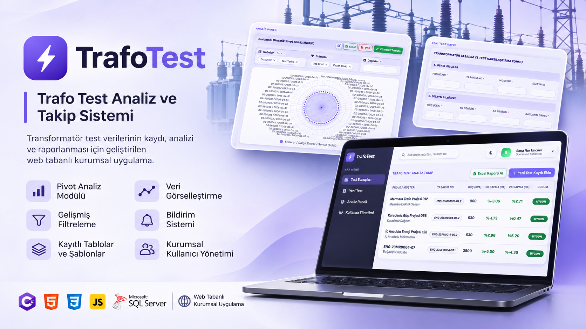
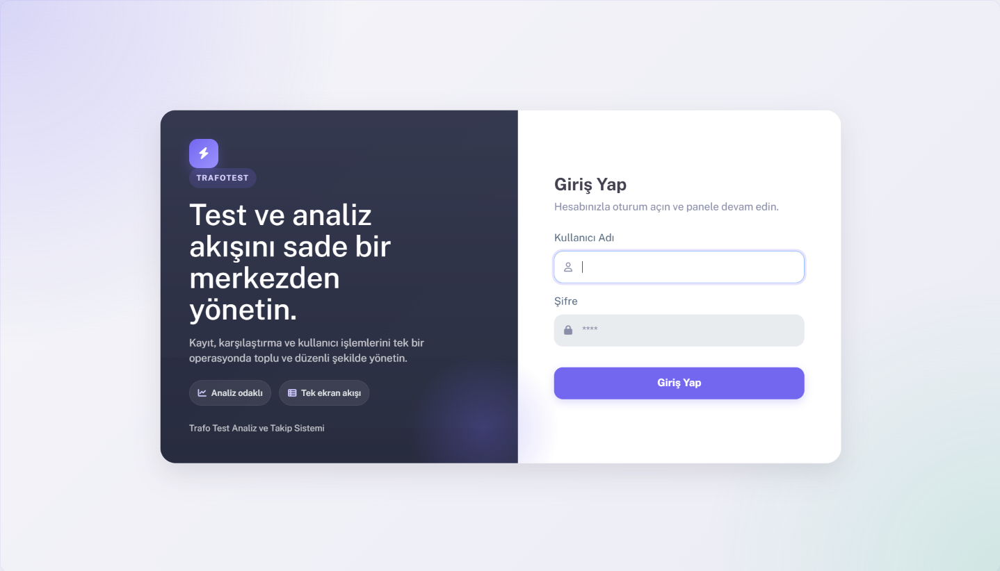
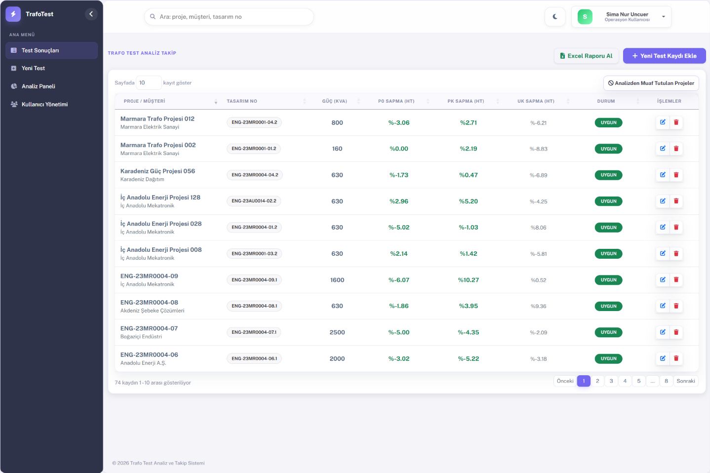
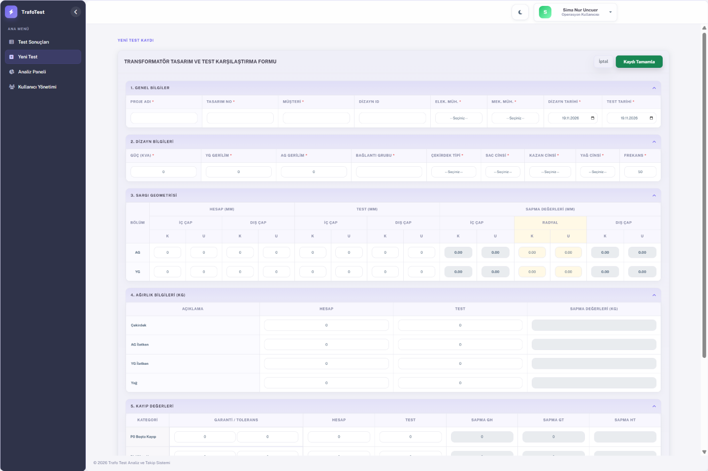
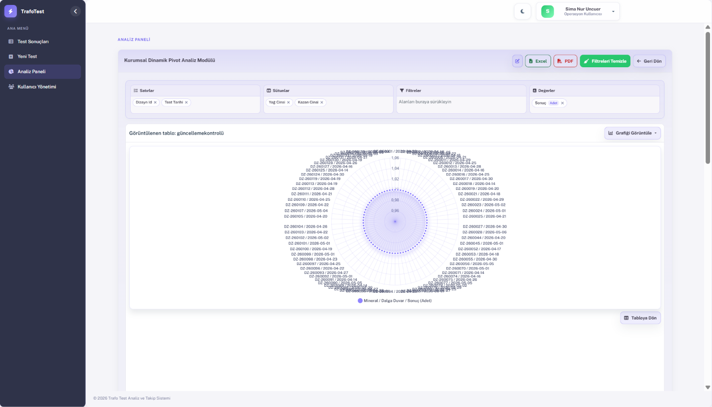

  

# TrafoTest

### Transformer Test Data Management & Reporting System

## Project Overview

TrafoTest is a web-based data management, analysis, and reporting application developed during a professional software development internship.

The project was designed to transform Excel-based transformer test data workflows into a centralized, interactive web application.

The system was developed from scratch and deployed for internal company use.

## Project Objectives

- Digitalize Excel-based data management processes
- Simplify data analysis and reporting workflows
- Provide interactive data visualization
- Improve data accessibility and usability
- Reduce repetitive manual operations

## Key Features

- Dynamic pivot tables
- Interactive charts and data visualization
- Real-time synchronization between tables and charts
- Advanced data filtering
- Saved table configurations and reusable templates
- Persistent application state
- Notification interface
- Centralized database management
- Corporate user interface

## Technologies

| Technology | Purpose |
|---|---|
| C# | Backend development |
| HTML5 | Interface structure |
| CSS3 | Interface design |
| JavaScript | Interactive functionality |
| Microsoft SQL Server | Database management |
| Visual Studio | Development environment |
| Git & GitHub | Version control |

## Development Responsibilities

- Full-stack application development
- Database integration
- Frontend and backend implementation
- Interactive reporting interface development
- Pivot table and chart synchronization
- Application state management
- Debugging and functionality improvements
- User interface and usability improvements

## Development Experience

This project provided hands-on experience in developing a real-world enterprise application, transforming business requirements into functional software, and improving existing operational workflows.

## Screenshots

## Application Screenshots

### 1. Login Interface

A clean authentication interface for accessing the application.

### 2. Test Results Dashboard

Centralized test records, deviation values, search functionality, status tracking, and Excel reporting.

### 3. Transformer Test Registration

A structured data entry form for transformer design specifications, measurements, and test comparisons.

### 4. Dynamic Analytics Panel

Interactive pivot analysis, configurable data visualization, filtering, and Excel/PDF export capabilities.

---

*The project cover is an AI-assisted promotional visualization based on the application interface.*

## Project Status

Completed and deployed for internal company use in 2026.

## Confidentiality

This repository serves exclusively as a professional project showcase.

Source code, production databases, internal documentation, and confidential company information are not publicly distributed.

## Developer

Developed as part of a professional software development internship.

---

*Transforming complex data into meaningful insights.*
